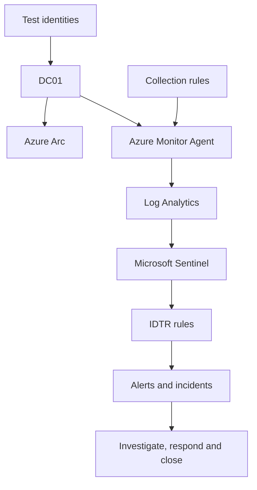
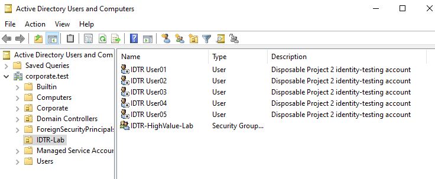
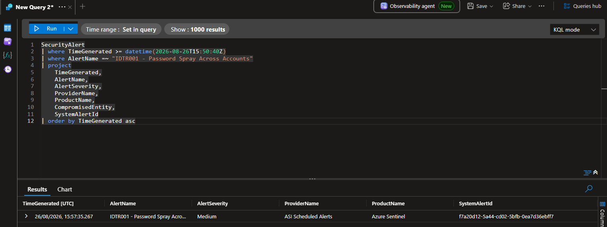
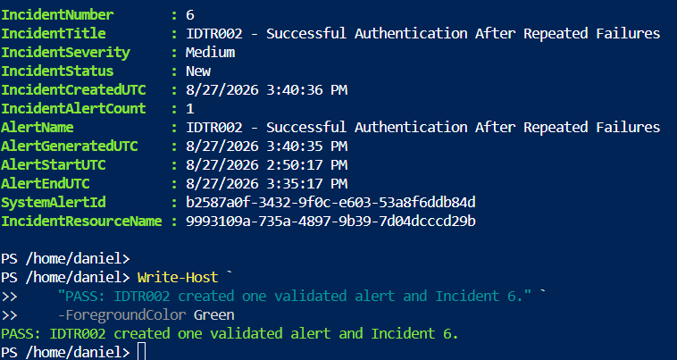
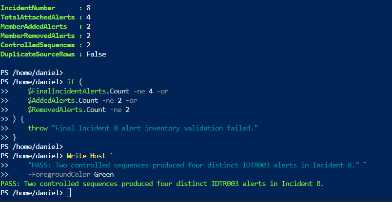
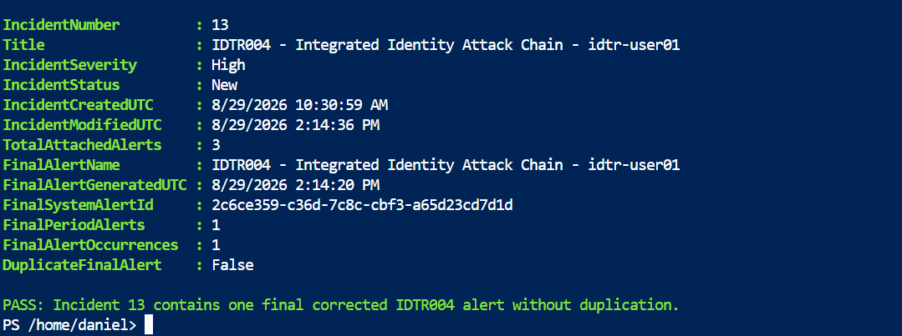
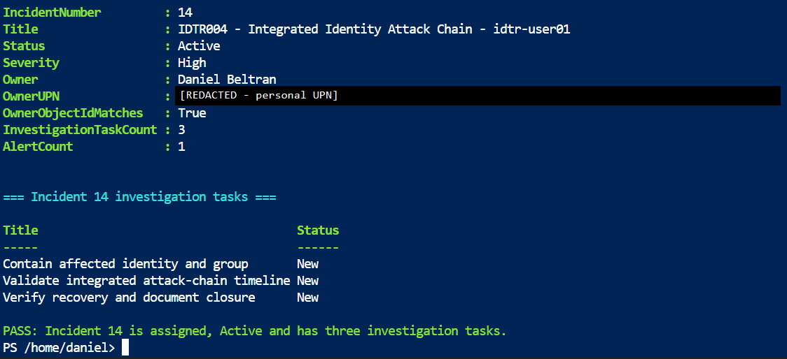
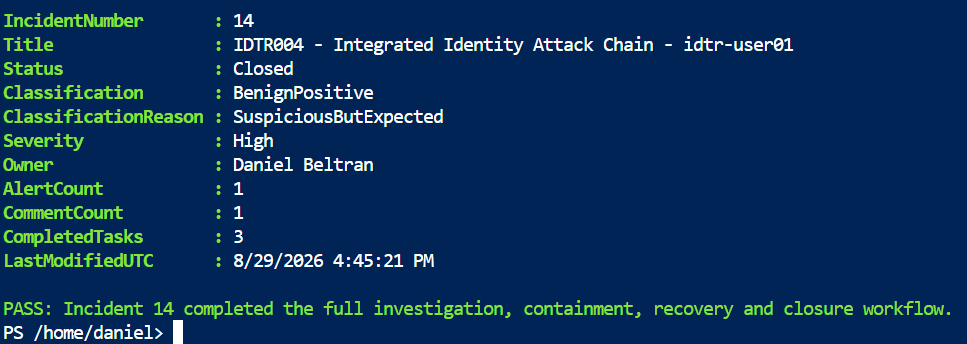

# Microsoft Identity Threat Detection and Response

Hands-on hybrid identity-security laboratory demonstrating how Windows
authentication and directory activity is collected, detected, investigated and
safely contained with Microsoft Sentinel.

## Executive summary

| Area | Validated outcome |
|---|---|
| Business problem | Detect and respond to identity compromise across authentication failures, later successes and privileged-group activity |
| Environment and scope | VMware-hosted Active Directory connected to Azure through Azure Arc, Azure Monitor Agent and Data Collection Rules |
| Implemented detections | Four Microsoft Sentinel rules covering password spraying, success after repeated failures, high-value group changes and an integrated attack chain |
| Strongest technical result | Correlated nine failures across five identities, a successful network logon and a subsequent high-value group addition |
| Final assurance | Investigated, safely contained, independently validated and closed the incident while restoring a known-good directory state |

| Project attribute | Current value |
|---|---|
| Status | Complete — Milestones 0–8 validated |
| Laboratory domain | `corporate.test` |
| Primary server | `DC01.corporate.test` |
| Azure region | UK South |
| Log Analytics workspace | `law-sentinel-siem-lab-uks` |
| Controlled identities | 5 disposable users |
| Completed detection rules | 4 |
| Evidence screenshots | 62 |
| Final recovery checkpoint | `P2-M08-Final-Validated-State` |

## What I implemented

- Designed four identity-focused Microsoft Sentinel detection scenarios.
- Created controlled PowerShell simulations with bounded scope and guaranteed
  cleanup.
- Profiled Windows Events `4624`, `4625`, `4728` and `4729` locally and in
  `SecurityEvent` before selecting detection fields.
- Developed and tuned KQL scheduled-rule logic for ingestion delay, overlapping
  execution windows and duplicate control.
- Validated Account, Host and Security Group entities without fabricating an IP
  entity when the source value was unusable.
- Investigated alerts and grouped incidents, assigned ownership, completed
  response tasks and recorded evidence-supported closure decisions.
- Implemented idempotent containment, independent recovery validation and a
  final powered-off recovery checkpoint.
- Documented engineering corrections, operational procedures and production
  limitations.

## Why this project exists

Identity attacks rarely appear as one self-explanatory alert. Analysts must
connect authentication failures, later successes, privileged changes, affected
identities, source hosts and current directory state before deciding whether an
incident is malicious, expected or contained.

This project demonstrates how raw Windows identity telemetry becomes a
defensible detection, analyst decision and verified response. It covers the
complete lifecycle rather than stopping after alert generation.

## Architecture

`DC01` is a VMware-hosted Windows Server domain controller. Azure Arc provides
the Azure management relationship; Azure Monitor Agent and Data Collection
Rules send selected event channels to the Microsoft Sentinel-enabled Log
Analytics workspace.

See the [complete architecture, trust boundaries and rollback design](architecture/01-identity-threat-detection-response-architecture.md).

## Key validated outcomes

- Reused and revalidated the completed Project 1 environment without modifying
  its users, groups or analytics rules.
- Created five isolated disposable identities and a synthetic high-value group
  that grants no administrative privilege.
- Confirmed fresh local and cloud telemetry before developing detections.
- Engineered four scheduled analytics rules with delay-aware query windows,
  entity mapping and evidence-supported MITRE ATT&CK alignment.
- Corrected duplicate-alert behaviour by separating event-time coverage from
  newly ingested records.
- Distinguished source events, query results, alerts and incidents when fresh
  alerts joined existing incidents.
- Correlated a controlled multi-stage chain containing password spraying,
  repeated failures, successful authentication and a high-value group addition.
- Completed an owned Incident `14` workflow with three investigation tasks,
  validated entities, analyst commentary and appropriate closure.
- Enforced idempotent containment and independently confirmed that all five
  disposable identities were disabled, unlocked and absent from the monitored
  group.
- Revalidated Active Directory, Azure Arc, Azure Monitor Agent, Data Collection
  Rules, fresh telemetry and preserved Project 1 rules at completion.
- Created the powered-off VMware checkpoint `P2-M08-Final-Validated-State` and
  passed the deterministic 95-file repository quality gate.

## Detection catalogue

| ID | Detection | Data and event IDs | Severity | MITRE ATT&CK | Status |
|---|---|---|---|---|---|
| IDTR001 | [Password Spray Across Accounts](docs/Password-Spray-Detection.md) | `SecurityEvent` — 4625 | Medium | Credential Access — T1110; T1110.003 documented | Complete |
| IDTR002 | [Successful Authentication After Repeated Failures](docs/Successful-Authentication-After-Repeated-Failures.md) | `SecurityEvent` — 4625 and 4624 | Medium | Credential Access — T1110; Initial Access — T1078 | Complete |
| IDTR003 | [High-Value Group Membership Change](docs/High-Value-Group-Membership-Change.md) | `SecurityEvent` — 4728 and 4729 | High | Persistence and Privilege Escalation — T1098; T1098.007 documented | Complete |
| IDTR004 | [Integrated Identity Attack Chain](docs/Integrated-Identity-Attack-Chain.md) | `SecurityEvent` — 4625, 4624 and 4728 | High | T1110, T1078 and T1098 | Complete |

## Recommended five-minute review

1. Understand the [architecture and trust boundaries](architecture/01-identity-threat-detection-response-architecture.md).
2. Examine the [IDTR004 integrated-chain detection](queries/IDTR004-IntegratedIdentityAttackChain.kql).
3. Review the [Incident 14 investigation, containment and recovery workflow](docs/Investigation-Containment-and-Recovery.md).
4. Read the principal [engineering lessons and corrections](lessons-learned.md).
5. Assess the documented [production limitations and improvement roadmap](docs/Production-Limitations-and-Improvements.md).

## Evidence highlights

The README shows only the strongest checkpoints. The milestone documents link
the complete 62-screenshot evidence sequence.

### Controlled Active Directory objects

### IDTR001 password-spray alert

### IDTR002 alert and incident

### IDTR003 grouped high-value group alerts

### IDTR004 integrated attack-chain incident

### Incident 14 investigation and response tasks

### Completed response workflow

### Final powered-off recovery checkpoint

## Implementation milestones

| Milestone | Documentation | Principal outcome | Status |
|---:|---|---|---|
| 0 | Repository foundation | Clean structure and controlled publication workflow | Complete |
| 1 | [Baseline and recovery checkpoint](docs/Baseline-and-Recovery-Checkpoint.md) | Environment health, ingestion and recovery validation | Complete |
| 2 | [Identity telemetry schema profile](docs/Identity-Telemetry-Schema-Profile.md) | Controlled objects, field profiling and safe cleanup | Complete |
| 3 | [Password-spray detection](docs/Password-Spray-Detection.md) | IDTR001 engineering, incident response and closure | Complete |
| 4 | [Successful authentication after failures](docs/Successful-Authentication-After-Repeated-Failures.md) | IDTR002 correlation and incident validation | Complete |
| 5 | [High-value group-membership activity](docs/High-Value-Group-Membership-Change.md) | IDTR003 state-change monitoring | Complete |
| 6 | [Integrated identity attack chain](docs/Integrated-Identity-Attack-Chain.md) | IDTR004 multi-event correlation | Complete |
| 7 | [Investigation, containment and recovery](docs/Investigation-Containment-and-Recovery.md) | End-to-end analyst workflow | Complete |
| 8 | Completion and quality review | Final repository and recovery validation | Complete |

## Reusable engineering artifacts

### Kusto Query Language

- [Validate the telemetry baseline](queries/Validate-IDTRTelemetryBaseline.kql)
- [Profile identity-security events](queries/Profile-IdentitySecurityEvents.kql)
- [Detect password spraying](queries/IDTR001-PasswordSpray.kql)
- [Detect successful authentication after failures](queries/IDTR002-SuccessAfterFailures.kql)
- [Detect high-value group-membership changes](queries/IDTR003-HighValueGroupMembershipChange.kql)
- [Correlate the integrated identity attack chain](queries/IDTR004-IntegratedIdentityAttackChain.kql)
- [Investigate an integrated incident timeline](queries/Investigate-IDTRIntegratedIncident.kql)

### PowerShell

- [Validate the Project 2 baseline](scripts/Test-Project2Baseline.ps1)
- [Retrieve the preserved Project 1 rule baseline](scripts/Get-Project1SentinelRuleBaseline.ps1)
- [Create controlled laboratory objects](scripts/New-IDTRLabObjects.ps1)
- [Generate controlled password-spray activity](scripts/Invoke-IDTRPasswordSpraySimulation.ps1)
- [Generate successful authentication after failures](scripts/Invoke-IDTRSuccessfulLogonAfterFailures.ps1)
- [Generate and reverse a high-value group change](scripts/Invoke-IDTRPrivilegedGroupChange.ps1)
- [Generate and restore the integrated attack chain](scripts/Invoke-IDTRIntegratedAttackChain.ps1)
- [Enforce idempotent identity containment](scripts/Invoke-IDTRIncidentContainment.ps1)
- [Verify directory recovery and fresh telemetry](scripts/Test-IDTRRecoveryState.ps1)
- [Restore the safe laboratory state](scripts/Restore-IDTRLabState.ps1)
- [Independently verify the final state](scripts/Test-IDTRFinalState.ps1)
- [Run deterministic validation of the completed repository](scripts/Test-Project2Repository.ps1)

### Operations and safe test data

- [Controlled test-object manifest](data/controlled-test-object-manifest.csv)
- [Identity incident triage and response runbook](runbooks/01-identity-threat-detection-response-runbook.md)
- [Production limitations and improvements](docs/Production-Limitations-and-Improvements.md)
- [Cross-milestone lessons learned](lessons-learned.md)

## Repository contents

| Path | Purpose |
|---|---|
| `architecture/` | Logical design, telemetry flow, trust boundaries and rollback |
| `data/` | Sanitised controlled-object inventory without credentials |
| `docs/` | Baselines, schema profiles, detection engineering and production guidance |
| `queries/` | Reusable KQL validation, profiling and detection queries |
| `runbooks/` | Analyst triage, response, escalation and closure procedures |
| `screenshots/` | Sanitised evidence captured after technical validation |
| `scripts/` | PowerShell validation, simulation, recovery and state-checking scripts |
| `lessons-learned.md` | Engineering decisions, defects, corrections and improvements |

## Validation and safe reproduction

The laboratory requires an authorised Active Directory environment, Azure Arc,
Azure Monitor Agent, appropriate Data Collection Rules, a Microsoft
Sentinel-enabled Log Analytics workspace and permission to create analytics
rules and manage incidents.

Recommended order:

1. Run `scripts/Test-Project2Baseline.ps1` as administrator on `DC01`.
2. Run `queries/Validate-IDTRTelemetryBaseline.kql` in Log Analytics.
3. Validate the controlled object manifest and final Active Directory state.
4. Generate one authorised scenario and confirm its local events.
5. Confirm cloud ingestion before expecting the scheduled rule to run.
6. Validate the rule, alert, incident, mapped entities and current directory
   state.
7. Record the analyst conclusion, restore the laboratory and verify recovery.
8. Run the deterministic repository validator from `scripts/` against the
   completed tree.

The repository must not be executed unchanged in production.

## Security controls and limitations

- All testing is confined to five disposable identities and a synthetic group
  that provides no real privilege.
- Authentication activity remains below the validated lockout threshold, and
  temporary membership is reversed through guaranteed-cleanup logic.
- Current Active Directory state is validated directly rather than inferred
  from historical events.
- No credentials, personal cloud identities, tenant identifiers, subscription
  identifiers or access tokens are stored in the repository.
- The laboratory contains one domain controller, one workspace, fixed test
  thresholds and limited identity, endpoint and network enrichment.
- It does not reproduce enterprise scale, high availability, formal change
  management, separation of duties or automated destructive response.
- Supported management interfaces were used when the graphical Sentinel
  experience repeatedly redirected or did not display persisted incidents.

See [Production Limitations and Improvements](docs/Production-Limitations-and-Improvements.md)
for the prioritised changes required before production use.

## Scope statement

This is an authorised hands-on laboratory built to validate identity-security
engineering methods. It demonstrates practical Microsoft Sentinel and
identity-security engineering, but it does not represent production Microsoft
Sentinel operational experience.

A production implementation would require representative identity volume,
multiple telemetry sources, formal approval, peer review, change control,
retention planning, environment-specific thresholds and approved response
procedures.
