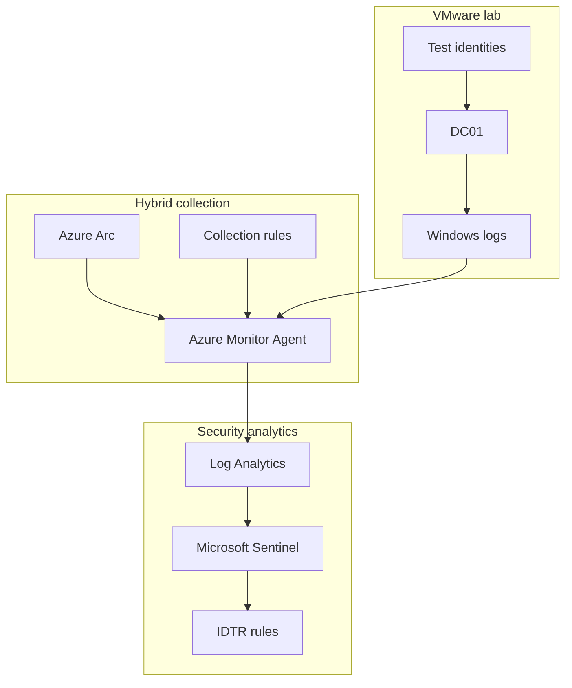
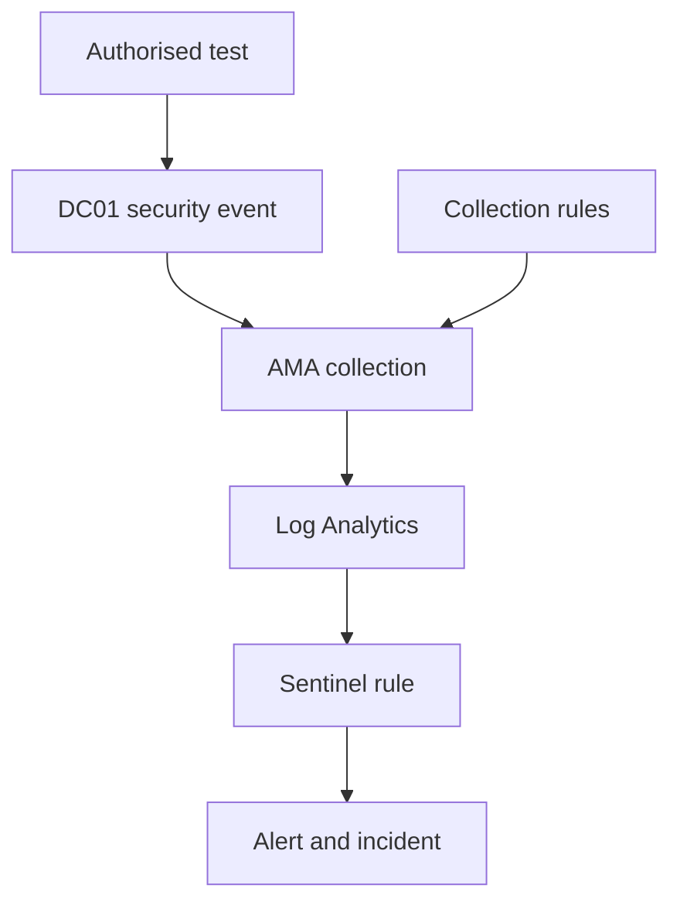
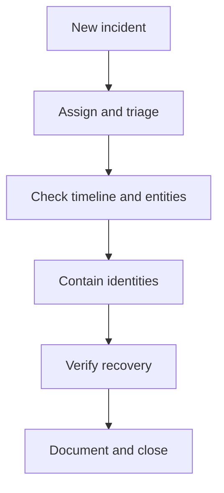

# Microsoft Identity Threat Detection and Response Architecture

## Purpose

This document describes the completed Project 2 architecture through Milestone 8.
It separates management connectivity, telemetry collection, detection logic and
analyst response so that a failure in one layer is not incorrectly diagnosed as
a failure in another.

The architecture reuses the authorised Project 1 environment while isolating
Project 2 objects and activity. The implemented detection layer now covers
password spraying, successful authentication after repeated failures,
high-value group-membership changes and a correlated integrated identity attack
chain.

## Laboratory environment

| Component | Validated role |
|---|---|
| `DC01.corporate.test` | VMware-hosted Windows Server domain controller and identity-event source |
| `OU=IDTR-Lab,DC=corporate,DC=test` | Isolation boundary for five disposable Project 2 users |
| `IDTR-HighValue-Lab` | Synthetic high-value monitoring marker with no real administrative privilege |
| Azure Arc | Azure resource and management relationship for `DC01` |
| Azure Monitor Agent | Local telemetry collector |
| Data Collection Rules | Event-channel selection and Log Analytics destination configuration |
| `law-sentinel-siem-lab-uks` | Log Analytics storage and query layer |
| Microsoft Sentinel | Scheduled detection, alert, entity, incident and response layer |

## Logical architecture

## Management plane and data plane

Azure Arc and Azure Monitor Agent solve different problems:

- Azure Arc represents and manages the non-Azure server as an Azure resource.
- Azure Monitor Agent reads the selected local event channels and forwards
  telemetry.
- Data Collection Rules define which data is collected and where it is sent.
- Log Analytics stores the resulting records in queryable tables.
- Microsoft Sentinel evaluates the records, maps entities and manages alerts and
  incidents.

An Arc status of **Connected** therefore does not prove that `SecurityEvent`
data is current. Collection health is established only when the agent, Data
Collection Rule association and fresh workspace rows all pass validation.

## Identity telemetry flow

Milestone 3 validated the flow with five Event ID `4625` records targeting
`idtr-user01` through `idtr-user05`. Milestone 4 validated a second path: five
Event `4625` invalid-password failures followed by one Event `4624` network
success for `idtr-user01`. Both sequences reached `SecurityEvent`, produced one
fresh alert and completed a mapped-incident investigation. Milestone 5
validated one Event `4728` addition followed by one Event `4729` removal for
`IDTR-HighValue-Lab`. During rule correction, two authorised sequences each
produced one addition and one removal alert. All four alerts were grouped into
one incident without duplicate source-row selection.

Milestone 6 validated the complete progression in one final controlled
sequence: nine Event `4625` failures across five identities, one Event `4624`
network success for `idtr-user01`, one Event `4728` addition and one Event
`4729` removal. IDTR004 correlated the failures, success and addition into one
High-severity alert. The final alert was attached exactly once to existing
Incident `13`.

Milestone 7 repeated the validated sequence after confirming the safe baseline
and rule readiness. One new alert created Incident `14`. The incident was
assigned, changed to Active and managed through three tasks covering
investigation, containment and recovery. The workflow ended with a validated
analyst record and evidence-supported closure.

Milestone 8 revalidated the domain and service baseline, Azure Arc components,
Azure Monitor Agent process, downloaded Data Collection Rule configuration and
the preserved Project 1 analytics rules. The final powered-off VMware checkpoint
`P2-M08-Final-Validated-State` was created only after those checks and the
Incident `14` recovery state had passed.

## Detection and incident layer

The implemented detection layer contains four independently validated rules:

| Control | IDTR001 password spray | IDTR002 success after failures |
|---|---|---|
| Event selection | `4625` invalid-password failures across controlled identities | `4625` failures followed by a `4624` network success for the same account and host |
| Threshold | Five failures against five distinct identities | Five failures before one success within 30 minutes |
| Schedule | 5-minute frequency; 15-minute period | 5-minute frequency; 45-minute period |
| Freshness guard | Failure ingestion in latest 5 minutes | Success ingestion in latest 5 minutes |
| Entity mapping | Account and Host; IP only if usable | Account and Host |
| Alert grouping | One alert for all matching rows | Alert per result |
| Incident grouping | `AllEntities`, 5-hour lookback | `Selected` entities, 5-hour lookback |

IDTR003 runs every five minutes with a 15-minute period and Alert-per-result
grouping. It maps the actor Account, affected-member Account SID, Host and
Security Group SID. Its ingestion-time filter processes records between five
and ten minutes old. This accounts for Sentinel's built-in five-minute
scheduled-rule delay while keeping consecutive processing windows
non-overlapping. Shared entities grouped the four alerts from two controlled
sequences into one incident with a 5-hour lookback.

IDTR004 runs every five minutes with a 75-minute query period and Alert-per-result
grouping. It correlates supporting failures and a successful authentication
within a 30-minute behavioural window, then anchors the result on a newly
ingested Event `4728` group addition. The final query applies
`ingestion_time() > ago(5m)` only to the chain-completing addition and returns
`TimeGenerated = GroupAddTimeUTC` for scheduled-rule compatibility. It maps the
target Account, actor Account, Host and Security Group SID. All mapped entities
are required for incident grouping.

Analytics-rule health monitoring is enabled through the SentinelHealth
settings resource. Only the `Analytics` diagnostic category is sent to the
existing workspace. This separates a healthy scheduler from query logic,
timing or output-schema failures.

The broader event-time periods accommodate measured ingestion delay. Each
query applies `ingestion_time()` to its anchor event so the same delayed record
is not selected by multiple overlapping evaluations. IDTR002 anchors on the
fresh success because the behavioural question is whether valid authentication
followed the failures.

## Analyst response layer

Incident tasks make response state explicit. Source telemetry remains the
authority for the event sequence, incident entities support navigation, direct
Active Directory queries establish containment and a fresh Event `4688`
establishes continued local and cloud telemetry health.

Containment is idempotent. The workflow changes an object only when its current
state requires it, then validates every controlled user and the synthetic
group. For Incident `14`, the generator had already restored the safe state,
so containment correctly applied zero changes. Exposure was not recreated
merely to demonstrate a visible response action.

## Trust boundaries

### Active Directory boundary

Project 2 scripts target only the `IDTR-Lab` organisational unit and
`IDTR-HighValue-Lab`. Project 1 identities, groups and policy objects remain
outside the mutation scope.

### Server-to-Azure boundary

`DC01` sends only Data Collection Rule-selected telemetry through the Azure
Monitor Agent path. Azure Arc management connectivity is not treated as proof
of log delivery.

### Administration boundary

PowerShell on `DC01` performs local directory validation and controlled test
generation. Azure Cloud Shell is used only for authenticated management-plane
operations when the preferred graphical interface is unavailable.

### Evidence boundary

Published evidence contains laboratory resource names and controlled identity
names where they explain the design. Passwords, tokens, personal email
addresses, tenant identifiers and subscription identifiers are excluded.

## Resilience and rollback

Rollback is layered from least disruptive to most disruptive:

1. Restore each controlled user's original enabled state.
2. Remove temporary membership from `IDTR-HighValue-Lab` through guaranteed
   cleanup logic.
3. Run `scripts/Restore-IDTRLabState.ps1`.
4. Independently run `scripts/Test-IDTRFinalState.ps1`.
5. Use the powered-off VMware snapshot only if logical recovery cannot restore
   the validated baseline.

The pre-deployment checkpoint `P2-M01-Pre-Identity-Threat-Lab` protects the
starting state. The final checkpoint `P2-M08-Final-Validated-State` protects the
completed, recovered state. Neither snapshot substitutes for targeted cleanup
or direct final-state verification.

## Failure isolation

| Observed symptom | Layer to validate first |
|---|---|
| No local Windows event | Test-generation method, audit policy and event channel |
| Authentication test produces `4624` but no `4625` failures | Authentication API and logon type; validate the local event contract before cloud testing |
| Local event exists but no `SecurityEvent` row | Azure Monitor Agent, Data Collection Rule association and ingestion delay |
| Workspace row exists but no alert | Rule state, query logic, rule timing and ingestion-time guard |
| Scheduled rule appears configured but produces no alert | Retrieve persistent enabled state; account for Sentinel's built-in five-minute execution delay |
| Rule executes successfully but threshold is not reached | Inspect `SentinelHealth`, query output schema, event-time range and ingestion-time anchor separately |
| Historical query returns a row but the scheduled rule does not alert | Confirm the query returns `TimeGenerated` and test again only after persistent enablement and activation delay |
| Alert exists but no newly created incident | Incident grouping and last-modified state |
| Missing IP entity | Raw source-address population and placeholder filtering |
| Removal event exists but exposure is uncertain | Current Active Directory user and group state |
| Incident interface shows no result but an alert exists | Paginated incident and attached-alert API retrieval |
| Containment reports zero changes | Confirm the account is disabled and unlocked and the group is empty |
| Directory state is safe but recovery is unproven | Required services, AMA process and fresh local-to-cloud event |

This order prevents later-stage troubleshooting from hiding an earlier broken
link in the monitoring chain.

## Scope and limitations

- One domain controller rather than a distributed production identity platform.
- Five controlled identities rather than representative enterprise volume.
- One Log Analytics workspace and one region.
- No Entra risk, endpoint detection and response or threat-intelligence
  enrichment in the current stage.
- Manual analyst decisions and idempotent laboratory containment only.
- No password reset, token revocation, endpoint isolation, ticketing or SOAR
  integration.
- Portal redirection required supported management-interface fallbacks for some
  rule and incident operations.

See [Production Limitations and Improvements](../docs/Production-Limitations-and-Improvements.md)
for the required production evolution.

## References

- [Azure Arc-enabled servers overview](https://learn.microsoft.com/en-us/azure/azure-arc/servers/overview)
- [Azure Monitor Agent overview](https://learn.microsoft.com/en-us/azure/azure-monitor/agents/azure-monitor-agent-overview)
- [Data Collection Rules overview](https://learn.microsoft.com/en-us/azure/azure-monitor/data-collection/data-collection-rule-overview)
- [Windows Security Events via Azure Monitor Agent](https://learn.microsoft.com/en-us/azure/sentinel/data-connectors/windows-security-events-via-ama)
- [Microsoft Sentinel scheduled analytics rules](https://learn.microsoft.com/en-us/azure/sentinel/scheduled-rules-overview)
- [Handle ingestion delay in scheduled analytics rules](https://learn.microsoft.com/en-us/azure/sentinel/ingestion-delay)
- [Monitor analytics-rule health and integrity](https://learn.microsoft.com/en-us/azure/sentinel/monitor-analytics-rule-integrity)
- [Turn on Microsoft Sentinel auditing and health monitoring](https://learn.microsoft.com/en-us/azure/sentinel/enable-monitoring)
- [Microsoft Sentinel incident investigation](https://learn.microsoft.com/en-us/azure/sentinel/investigate-incidents)
- [Microsoft Windows Event 4624 — An account was successfully logged on](https://learn.microsoft.com/en-us/previous-versions/windows/it-pro/windows-10/security/threat-protection/auditing/event-4624)
- [Microsoft Windows Event 4625 — An account failed to log on](https://learn.microsoft.com/en-us/previous-versions/windows/it-pro/windows-10/security/threat-protection/auditing/event-4625)
- [Microsoft Audit Security Group Management](https://learn.microsoft.com/en-us/previous-versions/windows/it-pro/windows-10/security/threat-protection/auditing/audit-security-group-management)
- [MITRE ATT&CK T1098.007 — Additional Local or Domain Groups](https://attack.mitre.org/techniques/T1098/007/)
