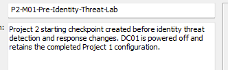
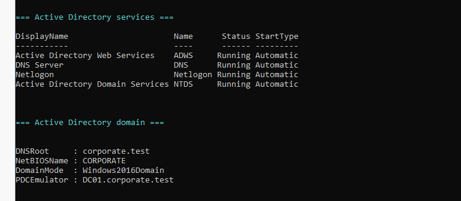
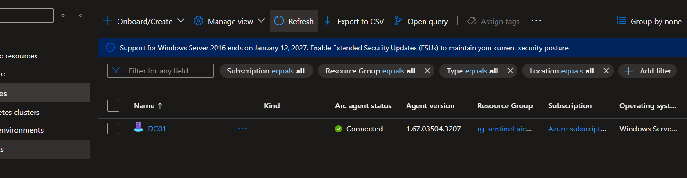
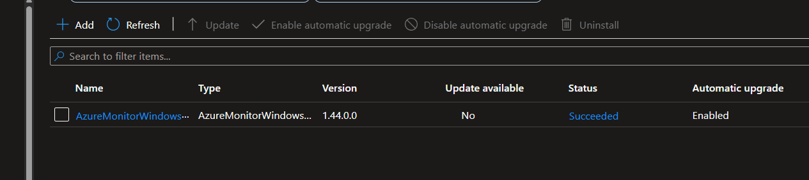
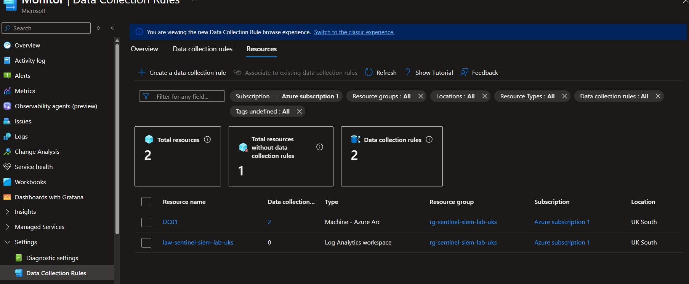
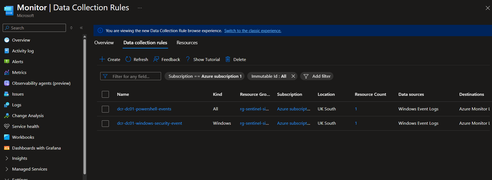
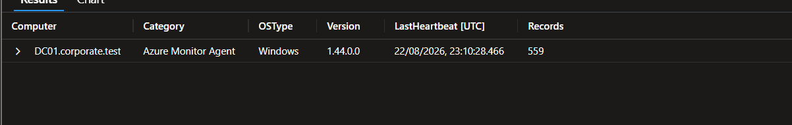
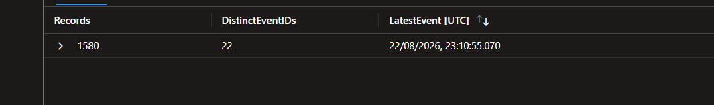
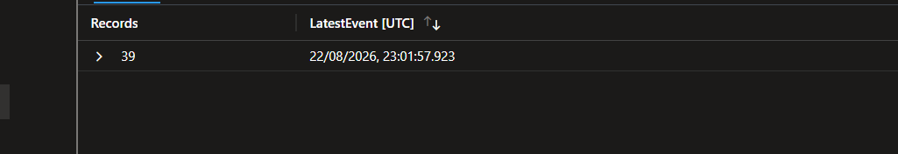
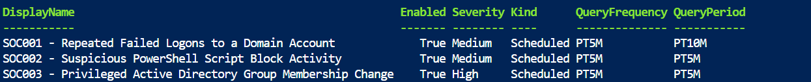

# Baseline and Recovery Checkpoint

## Purpose

This document records the validated starting state for **Microsoft Identity Threat Detection and Response** before any Project 2 test identities, attack simulations or analytics rules are created.

The baseline establishes that the domain controller, Active Directory, Azure Arc, Azure Monitor Agent, Data Collection Rules, Microsoft Sentinel telemetry and the completed Project 1 detections were healthy at the beginning of Project 2.

## Validation date and scope

- Validation date: 23 August 2026 (Europe/London)
- Domain controller: `DC01`
- Active Directory domain: `corporate.test`
- Microsoft Sentinel workspace: `law-sentinel-siem-lab-uks`
- Azure resource group: `rg-sentinel-siem-lab-uks`
- Validation type: read-only baseline inspection

No identities, group memberships, logging settings, agents, Data Collection Rules or Microsoft Sentinel analytics rules were modified during this milestone.

## Recovery checkpoint

The virtual machine was powered off before the recovery snapshot was created.

| Property | Validated value |
|---|---|
| Snapshot name | `P2-M01-Pre-Identity-Threat-Lab` |
| Purpose | Project 2 starting checkpoint before identity threat detection and response changes |
| Preserved state | Completed Project 1 configuration |
| Recovery use | Restore only if controlled object-level rollback cannot safely recover the lab |

## Active Directory baseline

| Check | Validated result |
|---|---|
| Computer name | `DC01` |
| Signed-in identity | `CORPORATE\Administrator` |
| Domain | `corporate.test` |
| Domain functional level | `Windows2016Domain` |
| Primary Domain Controller Emulator | `DC01.corporate.test` |
| Active Directory Domain Services | Running; automatic start |
| Domain Name System Server | Running; automatic start |
| Active Directory Web Services | Running; automatic start |
| Netlogon | Running; automatic start |

## Azure Arc and Azure Monitor Agent baseline

The Azure Arc machine showed a live **Connected** state after `DC01` was powered on.

| Component | Validated result |
|---|---|
| Azure Arc machine | `DC01` |
| Azure Arc status | Connected |
| Azure Connected Machine Agent version | `1.67.03504.3207` |
| Azure Monitor Agent extension | `AzureMonitorWindowsAgent` |
| Azure Monitor Agent version | `1.44.0.0` |
| Extension provisioning state | Succeeded |
| Automatic extension upgrade | Enabled |
| Local agent process | `MonAgentCore.exe` running |
| Downloaded configuration | `C:\Resources\Directory\AMADataStore.DC01\mcs\mcsconfig.latest.xml` present |
| Last-known-good configuration | `C:\Resources\Directory\AMADataStore.DC01\mcs\mcsconfig.lkg.xml` present |

## Data Collection Rule associations

Both existing Data Collection Rules were associated with the `DC01` Azure Arc machine in UK South.

| Data Collection Rule | Data source | Destination | Associated resource |
|---|---|---|---|
| `dcr-dc01-powershell-events` | Windows Event Logs | Azure Monitor Logs | `DC01` |
| `dcr-dc01-windows-security-event` | Windows Event Logs | Azure Monitor Logs | `DC01` |

## Telemetry validation

The workspace was queried only after local agent and control-plane checks had passed. The observed `Computer` value was `DC01.corporate.test`; an initial exact filter for `DC01` returned no results. This field difference was recorded and corrected instead of being hidden.

| Table and signal | Window | Observed result | Latest event in the validation run |
|---|---:|---:|---|
| `Heartbeat` — Azure Monitor Agent | 24 hours | 559 records | 22 August 2026 23:10:28.466 UTC |
| `SecurityEvent` — Windows Security events | 30 minutes | 1,580 records across 22 distinct Event Identifiers | 22 August 2026 23:10:55.070 UTC |
| `Event` — PowerShell Script Block Logging, Event Identifier 4104 | 30 minutes | 39 records | 22 August 2026 23:01:57.923 UTC |

For repeatable validation, run [`Validate-IDTRTelemetryBaseline.kql`](../queries/Validate-IDTRTelemetryBaseline.kql) in the Log Analytics workspace.

## Preserved Project 1 analytics rules

The existing Project 1 scheduled analytics rules were confirmed through the Microsoft Sentinel **List analytics rules** read operation.

| Rule | Enabled | Severity | Frequency | Lookback period |
|---|---:|---|---|---|
| `SOC001 - Repeated Failed Logons to a Domain Account` | Yes | Medium | 5 minutes | 10 minutes |
| `SOC002 - Suspicious PowerShell Script Block Activity` | Yes | Medium | 5 minutes | 5 minutes |
| `SOC003 - Privileged Active Directory Group Membership Change` | Yes | High | 5 minutes | 5 minutes |

These rules belong to Project 1. Project 2 will not rename, edit, disable or delete them.

## Interface limitation and justified fallback

Attempts to open the Microsoft Sentinel Analytics page through the graphical experience repeatedly redirected to the main Security Information and Event Management workspace page. Azure Resource Graph Explorer also returned no analytics-rule resources for this tenant.

Because both read-only interface routes failed, Azure Cloud Shell PowerShell was used for one authenticated `GET` request to the official Microsoft Sentinel **List analytics rules** endpoint. This fallback retrieved configuration only; it did not create or modify a resource.

This limitation must not be represented as a successful Analytics-page workflow. It is retained as transparent troubleshooting evidence and will be reassessed before Project 2 analytics rules are deployed.

## Revalidation procedure

1. Run [`Test-Project2Baseline.ps1`](../scripts/Test-Project2Baseline.ps1) as an administrator on `DC01`.
2. Confirm the Azure Arc machine status is **Connected** in the Azure portal.
3. Confirm `AzureMonitorWindowsAgent` shows **Succeeded** and automatic upgrade is enabled.
4. Confirm both Data Collection Rules remain associated with `DC01`.
5. Run [`Validate-IDTRTelemetryBaseline.kql`](../queries/Validate-IDTRTelemetryBaseline.kql) in `law-sentinel-siem-lab-uks`.
6. If the Analytics interface remains unavailable, run [`Get-Project1SentinelRuleBaseline.ps1`](../scripts/Get-Project1SentinelRuleBaseline.ps1) in Azure Cloud Shell PowerShell.
7. Stop if any required baseline check fails. Do not generate attack-simulation activity until the cause is understood.

## Milestone conclusion

Milestone 1 passed. The environment has a recoverable pre-project snapshot, Active Directory is healthy, Azure Arc is connected, Azure Monitor Agent is provisioned and running, both Data Collection Rules are associated, fresh telemetry is reaching the workspace, and all three Project 1 analytics rules remain enabled.
