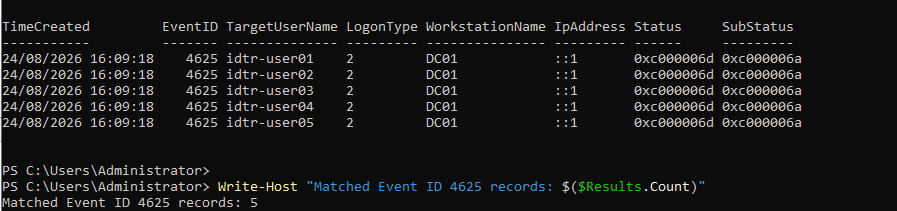
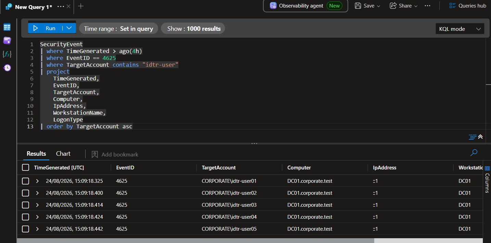
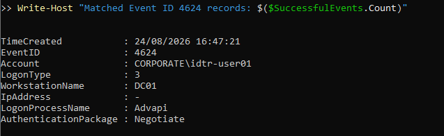
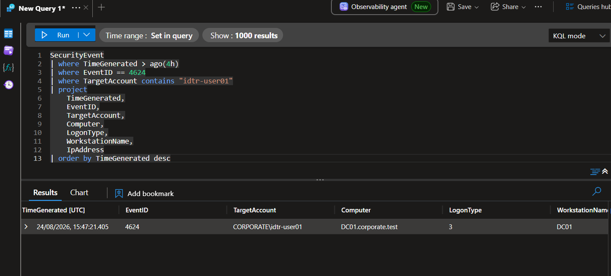
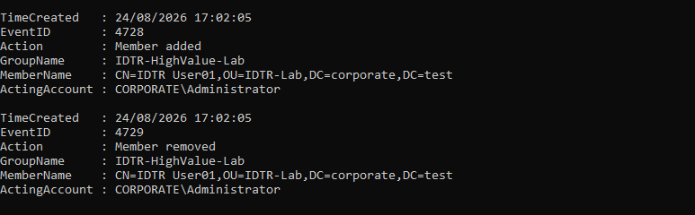
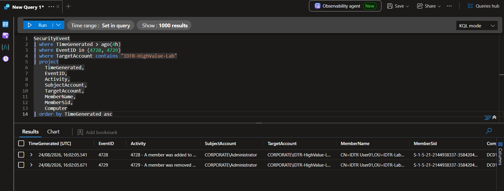
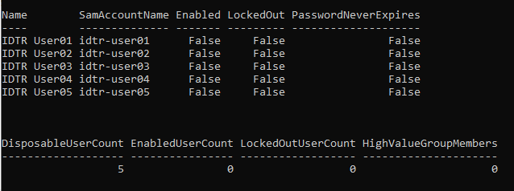

# Identity Telemetry Schema Profile

## Executive summary

Milestone 2 created a separate set of disposable Active Directory objects and generated three controlled identity-event patterns on `DC01`:

1. One failed authentication attempt against each of five test identities.
2. A later successful network authentication for one test identity.
3. A temporary membership change in a synthetic high-value security group, followed by guaranteed removal.

Each event pattern was validated first in the local Windows Security log and then in the Microsoft Sentinel `SecurityEvent` table. The observed field population—not a copied example schema—now provides the basis for the Project 2 analytics rules.

The milestone ended in a directly verified safe state: all five disposable accounts are disabled, none is locked out, and the high-value lab group has no members.

## Security objective

The objective was to establish which identity, host, logon, source-address, actor and group-membership fields are reliably populated in this single-domain-controller laboratory before building detections.

This avoids three common engineering errors:

- Building a rule around fields that are empty in the real data.
- Treating a loopback or missing address as a remote attacker address.
- Assuming that a laboratory high-value marker has the same privileges as a production administrative group.

## Controlled Active Directory objects

All Project 2 objects were placed in the protected `IDTR-Lab` organisational unit.

| Object | Identifier | Purpose | Final state |
|---|---|---|---|
| Organisational unit | `OU=IDTR-Lab,DC=corporate,DC=test` | Isolate disposable Project 2 objects | Present; protected from accidental deletion |
| Global security group | `IDTR-HighValue-Lab` | Synthetic high-value monitoring marker | Present; zero members |
| User | `idtr-user01` | Disposable identity-testing account | Disabled; not locked out |
| User | `idtr-user02` | Disposable identity-testing account | Disabled; not locked out |
| User | `idtr-user03` | Disposable identity-testing account | Disabled; not locked out |
| User | `idtr-user04` | Disposable identity-testing account | Disabled; not locked out |
| User | `idtr-user05` | Disposable identity-testing account | Disabled; not locked out |

The group has no delegated, local-administrator or domain-administrator rights. Its name identifies an investigation scenario; membership alone does not grant real privilege.

The complete safe object inventory is available in [`controlled-test-object-manifest.csv`](../data/controlled-test-object-manifest.csv). No password is stored in the manifest, scripts, screenshots or documentation.


## Safety controls

The domain lockout policy was checked before authentication testing.

| Control | Validated value |
|---|---:|
| Account lockout threshold | 10 failed attempts per account |
| Lockout duration | 15 minutes |
| Reset observation window | 15 minutes |
| Failed attempts generated | One per disposable identity |
| Permanent or privileged accounts targeted | None |

The same temporary lab password could be entered interactively for disposable accounts, but it was never printed or written to disk. Authentication scripts restore each account's original enabled state. Group-change logic uses `try`/`finally` cleanup and independently checks the final membership.

## Failed authentication profile

One deliberately invalid authentication was generated for each test identity. The five attempts occurred at the same controlled point in the test and remained well below the per-account lockout threshold.

### Local Windows Security result

Five matching Event ID `4625` records were confirmed on `DC01` at 24 August 2026 16:09:18 local time.

| Field | Observed value |
|---|---|
| `TargetUserName` | `idtr-user01` through `idtr-user05` |
| `LogonType` | `2` — interactive |
| `WorkstationName` | `DC01` |
| `IpAddress` | `::1` — IPv6 loopback |
| `Status` | `0xc000006d` — logon failure |
| `SubStatus` | `0xc000006a` — incorrect password |



### Microsoft Sentinel ingestion result

All five controlled failures reached `SecurityEvent` at approximately 15:09:18 UTC.

| Field | Observed value |
|---|---|
| `EventID` | `4625` |
| `Account` | `CORPORATE\idtr-user01` through `CORPORATE\idtr-user05` |
| `TargetAccount` | Same populated domain-qualified identity |
| `Computer` | `DC01.corporate.test` |
| `LogonType` | `2` |
| `WorkstationName` | `DC01` |
| `IpAddress` | `::1` |

A broad query also returned one unrelated `CORPORATE\Administrator` failure. The controlled event count is therefore five, not six. This confirms that analytics logic must scope the test identities before applying a threshold.



## Successful authentication profile

After the failed activity, `idtr-user01` was authenticated with the correct temporary credential through the Windows `LogonUserW` interface using network logon type `3`. The returned token handle was closed, the unmanaged password buffer was cleared, and the account's original disabled state was restored.

### Local Windows Security result

Event ID `4624` was confirmed at 24 August 2026 16:47:21 local time.

| Field | Observed value |
|---|---|
| `TargetDomainName` | `CORPORATE` |
| `TargetUserName` | `idtr-user01` |
| `LogonType` | `3` — network |
| `WorkstationName` | `DC01` |
| `IpAddress` | `-` |
| `LogonProcessName` | `Advapi` |
| `AuthenticationPackageName` | `Negotiate` |



### Microsoft Sentinel ingestion result

The matching `SecurityEvent` record arrived at 15:47:21.405 UTC.

| Field | Observed value |
|---|---|
| `EventID` | `4624` |
| `TargetAccount` | `CORPORATE\idtr-user01` |
| `Computer` | `DC01.corporate.test` |
| `LogonType` | `3` |
| `WorkstationName` | `DC01` |
| `IpAddress` | Empty |

The empty source-address field is a real schema limitation of this authentication context. It must remain empty in later queries and documentation; a source IP address must not be inferred or fabricated.



## High-value group-membership profile

`idtr-user01` was temporarily added to `IDTR-HighValue-Lab` and then removed in guaranteed-cleanup logic. The acting identity was `CORPORATE\Administrator`.

### Local Windows Security result

The Windows Security log recorded both sides of the state change at 24 August 2026 17:02:05 local time.

| Event ID | Action | Group | Member |
|---:|---|---|---|
| `4728` | Member added to a security-enabled global group | `IDTR-HighValue-Lab` | `CN=IDTR User01,OU=IDTR-Lab,DC=corporate,DC=test` |
| `4729` | Member removed from a security-enabled global group | `IDTR-HighValue-Lab` | `CN=IDTR User01,OU=IDTR-Lab,DC=corporate,DC=test` |



### Microsoft Sentinel ingestion result

Both events reached `SecurityEvent` at approximately 16:02:05 UTC.

| Field | Observed value |
|---|---|
| `SubjectAccount` | `CORPORATE\Administrator` |
| `TargetAccount` | `CORPORATE\IDTR-HighValue-Lab` |
| `MemberName` | Full distinguished name of `IDTR User01` |
| `Activity` | Rendered global-group member added or removed action |

This event family uses different identity roles from logon events: `SubjectAccount` identifies the actor, `TargetAccount` identifies the group, and `MemberName` identifies the changed member.



## Kusto Query Language field-selection lesson

The initial identity filter used:

```kusto
TargetAccount has "idtr-user"
```

It returned no results even though the events had arrived. Kusto `has` searches indexed terms, and the hyphenated account value did not behave as the intended substring filter. The validated condition is:

```kusto
TargetAccount contains "idtr-user"
```

The corrected filter returned all five controlled failures. Project 2 detection queries will therefore use `contains` for these hyphenated laboratory names unless a later schema profile proves that a more exact field or normalised identity is available.

The reusable profiling query is [`Profile-IdentitySecurityEvents.kql`](../queries/Profile-IdentitySecurityEvents.kql).

## Final-state validation

Cleanup was verified directly through Active Directory after all three event patterns had been ingested.

| Validation | Result |
|---|---:|
| Disposable users found | 5 |
| Enabled disposable users | 0 |
| Locked-out disposable users | 0 |
| Members of `IDTR-HighValue-Lab` | 0 |



An account count, a script completion message or a `4729` removal event alone would not prove cleanup. The final Active Directory state is the authoritative result.

## Reusable artifacts

- [`New-IDTRLabObjects.ps1`](../scripts/New-IDTRLabObjects.ps1) — creates or validates the protected organisational unit, synthetic high-value group and five disabled identities.
- [`Invoke-IDTRPasswordSpraySimulation.ps1`](../scripts/Invoke-IDTRPasswordSpraySimulation.ps1) — generates one controlled invalid attempt per disposable identity and restores original enabled states.
- [`Invoke-IDTRSuccessfulLogonAfterFailures.ps1`](../scripts/Invoke-IDTRSuccessfulLogonAfterFailures.ps1) — generates a network-logon success without storing the supplied credential.
- [`Invoke-IDTRPrivilegedGroupChange.ps1`](../scripts/Invoke-IDTRPrivilegedGroupChange.ps1) — creates and reverses the controlled high-value group membership with guaranteed cleanup.
- [`Restore-IDTRLabState.ps1`](../scripts/Restore-IDTRLabState.ps1) — disables and unlocks controlled users and removes only controlled memberships.
- [`Test-IDTRFinalState.ps1`](../scripts/Test-IDTRFinalState.ps1) — independently verifies the required safe state.
- [`controlled-test-object-manifest.csv`](../data/controlled-test-object-manifest.csv) — records the safe object inventory without credentials.

## Production considerations

- Use separate, approved test accounts and a non-production identity environment.
- Select lockout-aware test volumes that cannot deny service to permanent or privileged identities.
- Profile the populated fields for every domain controller, authentication protocol and connector path used in production.
- Treat loopback, private, public and missing source-address values according to their distinct investigation context.
- Monitor actual privileged groups through an approved high-value asset list; do not infer privilege from a group name.
- Separate the acting identity, changed group and changed member when investigating group-management events.
- Baseline normal authentication volume before setting password-spray thresholds.
- Retain guaranteed cleanup and independent final-state verification for every controlled identity test.

## Milestone conclusion

Milestone 2 passed. The disposable object set exists, the required Windows events were generated and locally confirmed, all controlled records were ingested into `SecurityEvent`, the populated fields and limitations were documented, and Active Directory returned to the required safe state.

No Microsoft Sentinel analytics rule was created in this milestone. Detection engineering begins in Milestone 3 using the observed schema recorded here.

## References

- [Azure Monitor Logs reference — SecurityEvent table](https://learn.microsoft.com/en-us/azure/azure-monitor/reference/tables/securityevent)
- [Microsoft Windows Audit Logon](https://learn.microsoft.com/en-us/previous-versions/windows/it-pro/windows-10/security/threat-protection/auditing/audit-logon)
- [Microsoft Windows Audit Security Group Management](https://learn.microsoft.com/en-us/previous-versions/windows/it-pro/windows-10/security/threat-protection/auditing/audit-security-group-management)
- [Microsoft Win32 LogonUserW function](https://learn.microsoft.com/en-us/windows/win32/api/winbase/nf-winbase-logonuserw)
- [Kusto string operators](https://learn.microsoft.com/en-us/kusto/query/datatypes-string-operators?view=microsoft-fabric)
- [MITRE ATT&CK T1110.003 — Password Spraying](https://attack.mitre.org/techniques/T1110/003/)
