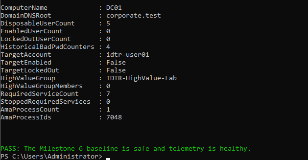
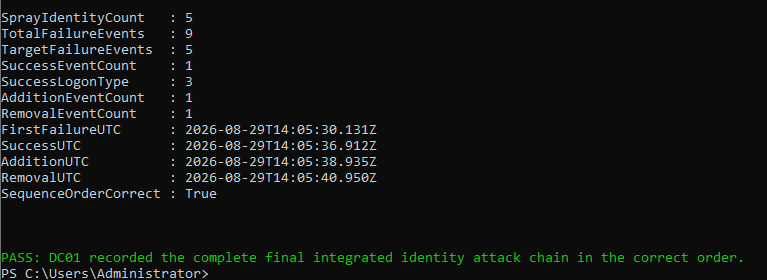
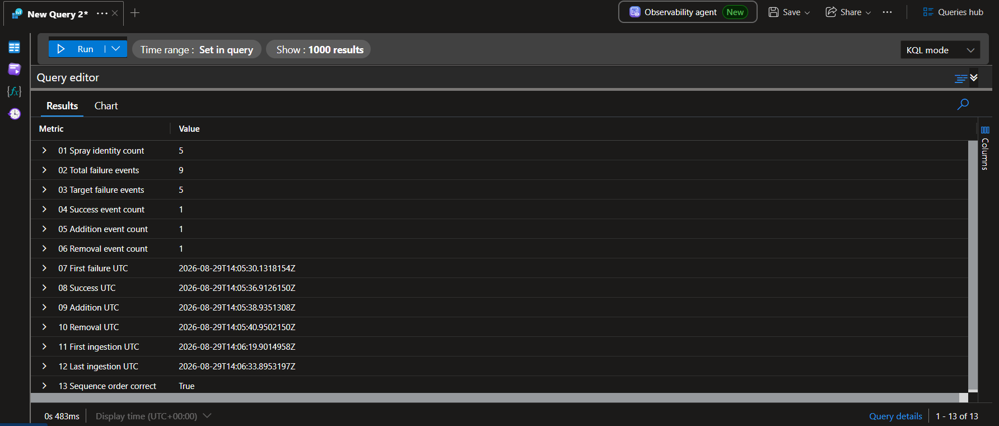
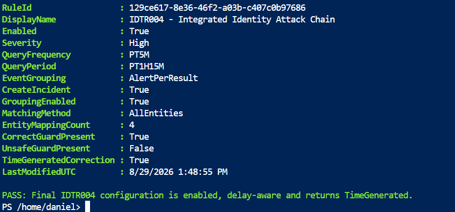
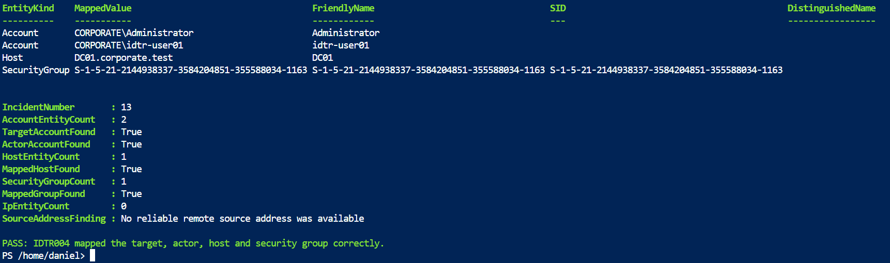
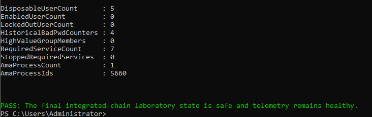
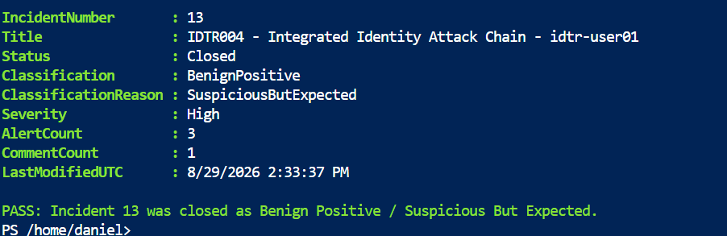

# Integrated Identity Attack-Chain Detection

## Purpose

Milestone 6 implements and validates `IDTR004 - Integrated Identity Attack
Chain`. The rule correlates three behaviours that are more significant together
than when reviewed as isolated alerts:

1. Password spraying across multiple controlled identities.
2. Repeated invalid-password failures followed by a successful network
   authentication for one targeted identity.
3. Addition of that authenticated identity to a monitored high-value group.

The laboratory uses five disposable accounts and the synthetic
`IDTR-HighValue-Lab` group. The group grants no real administrative privilege.
The sequence is authorised, rate-limited, automatically reversed and followed
by independent state validation.

Before rule engineering, the baseline confirmed that all five disposable users
were disabled and unlocked, the synthetic group was empty, all required Active
Directory and Azure Arc services were running, Azure Monitor Agent was healthy,
and a fresh harmless Event `4688` reached `SecurityEvent`.

Evidence:


## Detection objective

The analytic identifies a possible progression from credential guessing to use
of a valid domain account and then account manipulation. It requires all of the
following on `DC01.corporate.test`:

| Stage | Validated condition |
|---|---|
| Password spray | At least five Event `4625` invalid-password failures across at least five identities |
| Valid authentication | Event `4624` with network logon type `3` |
| Privilege-related change | Event `4728` adds the authenticated identity to `IDTR-HighValue-Lab` |
| Correlation order | Failures precede success; success precedes group addition |

Event `4729` removal is collected and validated as response evidence, but it is
not required to trigger the detection. A removal cannot retroactively eliminate
the exposure created by the preceding addition.

## Validated source contract

The final controlled sequence produced:

| Evidence | Validated value |
|---|---|
| Spray identities | 5 |
| Total Event `4625` failures | 9 |
| Failures targeting `idtr-user01` | 5 |
| Event `4624` network successes | 1 |
| Event `4728` additions | 1 |
| Event `4729` removals | 1 |
| First failure | `2026-08-29T14:05:30.131Z` |
| Successful authentication | `2026-08-29T14:05:36.912Z` |
| Group addition | `2026-08-29T14:05:38.935Z` |
| Group removal | `2026-08-29T14:05:40.950Z` |
| First cloud ingestion | `2026-08-29T14:06:19.901Z` |
| Last cloud ingestion | `2026-08-29T14:06:33.895Z` |
| Sequence order | Correct |

Evidence:

### Local attack-chain sequence



### Cloud-ingested attack-chain sequence



## Safe simulation design

The reusable script is
[`Invoke-IDTRIntegratedAttackChain.ps1`](../scripts/Invoke-IDTRIntegratedAttackChain.ps1).
It performs the following guarded workflow:

1. Confirms all five accounts start disabled and unlocked inside `IDTR-Lab`.
2. Confirms `IDTR-HighValue-Lab` starts empty.
3. Checks the domain lockout policy and historical bad-password timing before
   generating failures.
4. Generates a cryptographically random temporary password in memory.
5. Produces one controlled failed network authentication for each identity.
6. Produces four additional failures and one successful network logon for
   `idtr-user01`.
7. Adds and removes that identity from the synthetic group.
8. Uses `finally` cleanup to remove membership and disable all disposable
   accounts even if an intermediate operation fails.
9. Clears in-memory password variables and validates the local event sequence.

The script stores no password, token or reusable credential in the repository.

## Final KQL design

The exact persistently retrieved query is
[`IDTR004-IntegratedIdentityAttackChain.kql`](../queries/IDTR004-IntegratedIdentityAttackChain.kql).

The query uses a 75-minute source-event horizon and a 30-minute behavioural
correlation window. Failures must precede the successful authentication, and the
success must precede the group addition. The successful account name must match
the account derived from the added member's distinguished name.

The persisted query correlates the password-spray aggregate to the later stages
by `Computer`. It does not require a fixed number of failures for the account
that later succeeds. The final controlled evidence did contain five failures
for `idtr-user01`, and `TargetIdentities` proves that account was included in the
spray, but that observed fact is not an additional query threshold. Production
tuning should decide whether to require explicit successful-account membership
in the failed-identity set.

Only the chain-completing group-addition stream receives the freshness guard:

```kusto
| where ingestion_time() > ago(5m)
```

This preserves the longer supporting-event horizon while limiting each
five-minute evaluation to newly ingested group additions. Microsoft Sentinel's
scheduled-rule documentation explains why ingestion time must be considered
separately from source event time. The query also returns the timestamp column
required by the scheduled analytics engine:

```kusto
| extend TimeGenerated = GroupAddTimeUTC
```

### Corrected engineering defects

Validation exposed several defects before the final evidence run:

- The first Security Group entity mapping used `Sid`; the supported identifier
  is case-sensitive `SID`.
- An update payload copied the read-only `lastModifiedUtc` property and was
  rejected by the API.
- A standalone PASS command was previously run after a validation exception;
  persistent readback correctly showed that the rule was still disabled.
- The original query did not return `TimeGenerated`, so the historical query
  could correlate the chain but the scheduled rule could not create the final
  alert reliably.
- The freshness logic was corrected and then validated against a new controlled
  sequence after the activation wait had elapsed.

No PASS message was accepted as evidence until an independent GET confirmed the
persisted configuration.

## Rule configuration

| Setting | Persistently validated value |
|---|---|
| Display name | `IDTR004 - Integrated Identity Attack Chain` |
| Severity | High |
| Enabled | Yes |
| Frequency | 5 minutes |
| Period | 1 hour 15 minutes |
| Trigger | Results greater than 0 |
| Event grouping | Alert per result |
| Incident creation | Enabled |
| Incident grouping | All mapped entities |
| Entity mappings | 4 |
| ATT&CK tactics | Credential Access; Initial Access; Persistence; Privilege Escalation |
| Deployed techniques | T1110; T1078; T1098 |

Evidence:


## Rule-health monitoring

Because the graphical analytics experience repeatedly failed to expose the
required execution state, Microsoft Sentinel analytics health monitoring was
enabled for the `SentinelHealth` resource. The diagnostic setting sends the
`Analytics` category to the existing Log Analytics workspace while leaving the
unneeded `Automation` and `DataConnectors` categories disabled.

`SentinelHealth` confirmed that IDTR004 executed successfully during
troubleshooting even when an earlier evaluation returned zero results. This
separated scheduler health from query-window and output-schema defects.

## Alert and incident result

The final corrected execution generated:

| Field | Validated value |
|---|---|
| Alert name | `IDTR004 - Integrated Identity Attack Chain - idtr-user01` |
| Severity | High |
| Generated | `2026-08-29T14:14:20Z` |
| System alert ID | `2c6ce359-c36d-7c8c-cbf3-a65d23cd7d1d` |
| Incident | `13` |
| Incident resource | `f89e5c01-e4a1-4cb5-948f-0d60b5beb507` |

The alert was grouped into existing Incident `13`. The incident contained three
alerts from three separate authorised executions. The final corrected period
contained exactly one alert, and the final system alert ID occurred exactly
once. The earlier two alerts were retained and documented honestly; they were
not duplicates of the final source sequence.

Evidence:


## Entity mapping

Incident `13` contained four validated entities:

| Entity | Validated result |
|---|---|
| Target Account | `CORPORATE\idtr-user01` |
| Actor Account | `CORPORATE\Administrator` |
| Host | `DC01.corporate.test` |
| Security Group | SID ending `-1163` |

No IP entity was created because the authentication method did not provide a
reliable remote source address. No address was inferred or invented.

Evidence:


## Response and closure

Independent Active Directory and service validation confirmed:

- Five disposable users existed.
- Zero disposable users were enabled.
- Zero disposable users were locked.
- `IDTR-HighValue-Lab` contained zero members.
- All seven required services were running.
- Azure Monitor Agent was running.

Four disabled users retained historical nonzero `badPwdCount` values. These
counters were recorded but did not represent active access, lockout or group
membership.

Evidence:


The analyst comment documented the authorised sequence, exact final alert,
mapped entities, missing source address and restored state. Incident `13` was
then persistently retrieved as closed with three alerts and one comment,
classified **Benign Positive / Suspicious But Expected**. The behaviour was
suspicious and correctly detected, but it was authorised and fully reversed.

Evidence:


## Investigation guidance

For an unplanned production alert, analysts should establish:

1. Whether the spray targets include privileged, service or emergency-access
   identities.
2. Whether the successful authentication is expected for the account, host,
   protocol and time.
3. Whether the group addition was approved and whether membership remains
   active.
4. What the authenticated account did between success and containment.
5. Whether the same actor, target or host appears in other incidents.
6. Whether endpoint, Entra, VPN, network or identity-risk telemetry expands the
   scope.
7. Whether missing source-address context prevents a defensible conclusion.

## Production considerations

- Replace fixed laboratory thresholds with identity-class and source-aware
  baselines derived from representative history.
- Use governed inventories for privileged identities and groups, preferably by
  stable identifier.
- Correlate with endpoint, Entra sign-in, VPN, identity-risk and change-approval
  evidence.
- Monitor `SentinelHealth` and alert on failed, delayed or unexpectedly empty
  rule executions.
- Test ingestion-time guards and query output schemas in deployment pipelines.
- Keep human approval around destructive containment unless emergency authority
  is explicitly defined.

## References

- [Handle ingestion delay in scheduled analytics rules](https://learn.microsoft.com/en-us/azure/sentinel/ingestion-delay)
- [Create scheduled analytics rules in Microsoft Sentinel](https://learn.microsoft.com/en-us/azure/sentinel/create-analytics-rules)
- [Monitor analytics-rule health and integrity](https://learn.microsoft.com/en-us/azure/sentinel/monitor-analytics-rule-integrity)
- [Turn on auditing and health monitoring in Microsoft Sentinel](https://learn.microsoft.com/en-us/azure/sentinel/enable-monitoring)
- [Microsoft Sentinel health tables reference](https://learn.microsoft.com/en-us/azure/sentinel/health-table-reference)
- [Entities in Microsoft Sentinel](https://learn.microsoft.com/en-us/azure/sentinel/entities)
- [Microsoft Windows Event 4624 — successful logon](https://learn.microsoft.com/en-us/previous-versions/windows/it-pro/windows-10/security/threat-protection/auditing/event-4624)
- [Microsoft Windows Event 4625 — failed logon](https://learn.microsoft.com/en-us/previous-versions/windows/it-pro/windows-10/security/threat-protection/auditing/event-4625)
- [Advanced Audit Policy Configuration](https://learn.microsoft.com/en-us/windows-server/identity/ad-ds/plan/security-best-practices/advanced-audit-policy-configuration)
- [MITRE ATT&CK T1110.003 — Password Spraying](https://attack.mitre.org/techniques/T1110/003/)
- [MITRE ATT&CK T1078 — Valid Accounts](https://attack.mitre.org/techniques/T1078/)
- [MITRE ATT&CK T1098.007 — Additional Local or Domain Groups](https://attack.mitre.org/techniques/T1098/007/)
