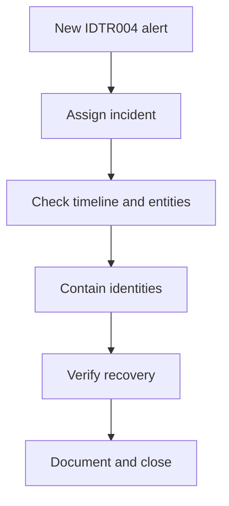

# Investigation, Containment and Recovery

## Purpose

Milestone 7 turns the validated IDTR004 detection into a complete analyst
workflow. It records how a fresh integrated identity attack-chain incident was
triaged, assigned, investigated, safely contained, independently recovered and
closed with an evidence-supported classification.

The exercise was authorised and used only disposable `IDTR-Lab` identities and
the synthetic `IDTR-HighValue-Lab` group. The response decisions were based on
the evidence, not on advance knowledge that the activity was a test.

## Validated workflow

Incident `14` was created from one fresh High-severity IDTR004 alert. It was
assigned to the analyst, changed to Active and given three investigation tasks:

1. Validate the integrated attack-chain timeline.
2. Contain the affected identity and group.
3. Verify recovery and document closure.

All three tasks were completed before the incident was closed.

## Source-event validation

The controlled sequence produced the following contract on
`DC01.corporate.test`:

| Evidence | Validated value |
|---|---:|
| Spray identities | 5 |
| Event `4625` failures | 9 |
| Failures for the successful account | 5 |
| Event `4624` network successes | 1 |
| Event `4728` additions | 1 |
| Event `4729` removals | 1 |
| Sequence order correct | True |

The first failure occurred at `2026-08-29T16:05:08.8587846Z`, followed by the
network success at `16:05:15.7205441Z`, group addition at
`16:05:17.7493049Z` and removal at `16:05:19.7743898Z`. The records were
available in `SecurityEvent` by `16:05:55.5821604Z`.

The reusable [incident investigation query](../queries/Investigate-IDTRIntegratedIncident.kql)
returns the relevant source records in chronological order without embedding
the evidence dates.

## Alert and incident validation

| Property | Validated value |
|---|---|
| Incident | `14` |
| Incident resource name | `4b2f93b4-c5ef-441c-a47c-a8e825d6387b` |
| Alert name | `IDTR004 - Integrated Identity Attack Chain - idtr-user01` |
| Severity | High |
| System alert ID | `1268e268-7bee-1646-99e1-22dc44f25397` |
| Source result count | 1 |
| Mapped ATT&CK techniques | T1110, T1078 and T1098 |

The alert description correctly stated that password spraying across five
controlled identities was followed by a successful authentication for
`CORPORATE\idtr-user01` and addition to `IDTR-HighValue-Lab`.

The incident interface initially showed zero results. A paginated read-only
management-interface query proved that Incident `14` and its alert existed.
This fallback was used for validation only; it did not change the alert or
incident.

## Entity investigation

The source fields and incident entities agreed:

| Entity | Validated value |
|---|---|
| Target Account | `CORPORATE\idtr-user01` |
| Actor Account | `CORPORATE\Administrator` |
| Host | `DC01.corporate.test` |
| Security Group SID | `S-1-5-21-2144938337-3584204851-355588034-1163` |
| IP | Not mapped; no reliable remote source address was available |

No placeholder or guessed IP entity was created.

## Containment

The containment script is deliberately idempotent. It disables the target only
if enabled, unlocks it only if locked and removes it from the monitored group
only if present. It then validates the complete controlled-object state.

At containment time, `idtr-user01` was already disabled, unlocked and absent
from `IDTR-HighValue-Lab` because the controlled generator had restored the
safe state. Therefore `ChangesApplied` was `0`. This is a valid containment
result: recreating exposure merely to demonstrate a mutation would have been
unsafe and would not improve the evidence.

Use [Invoke-IDTRIncidentContainment.ps1](../scripts/Invoke-IDTRIncidentContainment.ps1)
only on the authorised laboratory domain controller.

## Recovery validation

Recovery was established independently after containment:

- Five disposable users existed; none was enabled or locked.
- `IDTR-HighValue-Lab` had zero members.
- All seven required services were running.
- One Azure Monitor Agent process was running.
- The Windows Security log was enabled.
- A fresh harmless Event `4688` for `whoami.exe` was recorded locally and then
  observed in `SecurityEvent`.

Historical `badPwdCount` values remained on four disabled, unlocked users.
Those counters describe prior failed authentication and were not treated as a
current unsafe state.

Use [Test-IDTRRecoveryState.ps1](../scripts/Test-IDTRRecoveryState.ps1) for the
local recovery check. Cloud ingestion must still be confirmed separately.

## Analyst record and closure

The analyst record captured the alert, timeline, mapped entities, absence of a
reliable IP, idempotent containment result, recovery evidence and authorised
test context. The three tasks were confirmed Complete before closure.

Incident `14` was closed as **Benign Positive / Suspicious But Expected**. The
detection correctly identified genuinely suspicious activity, but the activity
was authorised, controlled and safely restored. Calling it a false positive
would incorrectly imply that the detection logic was wrong.

## Evidence

| File | What it proves |
|---|---|
| `m07-01-investigation-response-baseline.png` | Safe starting state and healthy telemetry |
| `m07-02-idtr004-response-prerequisites.png` | IDTR004 readiness and closed prior incident |
| `m07-03-controlled-chain-generation.png` | Controlled chain generation and automatic restoration |
| `m07-04-fresh-chain-cloud-ingestion.png` | Complete cloud sequence and field validation |
| `m07-05-fresh-idtr004-incident.png` | Fresh Incident 14 and attached alert |
| `m07-06-active-incident-and-tasks.png` | Assignment, Active status and three tasks |
| `m07-07-validated-incident-investigation.png` | Timeline and entity investigation result |
| `m07-08-validated-identity-containment.png` | Idempotent containment and isolated identity |
| `m07-09-verified-recovery-state.png` | Safe directory state and healthy local telemetry |
| `m07-10-post-containment-cloud-telemetry.png` | Fresh recovery event ingested into the workspace |
| `m07-11-completed-tasks-and-analyst-record.png` | Completed tasks and validated analyst record |
| `m07-12-closed-response-workflow.png` | Final classification and closure |

## Production improvements

- Replace individual analyst ownership with an approved queue and escalation
  model.
- Integrate ticketing, change approval and evidence retention.
- Add Entra, endpoint, network and asset-criticality context.
- Define authorised password reset, token revocation, endpoint isolation and
  broader group-review procedures.
- Automate only low-risk, reversible actions with approval gates and rollback.
- Monitor incident-interface availability and preserve a supported API
  contingency.
- Measure response and recovery times against documented service objectives.

## References

- [Investigate incidents in Microsoft Sentinel](https://learn.microsoft.com/en-us/azure/sentinel/investigate-incidents)
- [Navigate and triage incidents in Microsoft Sentinel](https://learn.microsoft.com/en-us/azure/sentinel/incident-navigate-triage)
- [Microsoft Sentinel incident create or update API](https://learn.microsoft.com/en-us/rest/api/securityinsights/incidents/create-or-update?view=rest-securityinsights-2025-09-01)
- [Microsoft Sentinel incident comment API](https://learn.microsoft.com/en-us/rest/api/securityinsights/incident-comments/create-or-update?view=rest-securityinsights-2025-09-01)
- [Microsoft Sentinel incident task API](https://learn.microsoft.com/en-us/rest/api/securityinsights/incident-tasks/create-or-update?view=rest-securityinsights-2025-09-01)
- [List alerts attached to a Microsoft Sentinel incident](https://learn.microsoft.com/en-us/rest/api/securityinsights/incidents/list-alerts?view=rest-securityinsights-2025-09-01)
- [List entities attached to a Microsoft Sentinel incident](https://learn.microsoft.com/en-us/rest/api/securityinsights/incidents/list-entities?view=rest-securityinsights-2025-09-01)
- [MITRE ATT&CK T1110 — Brute Force](https://attack.mitre.org/techniques/T1110/)
- [MITRE ATT&CK T1078 — Valid Accounts](https://attack.mitre.org/techniques/T1078/)
- [MITRE ATT&CK T1098 — Account Manipulation](https://attack.mitre.org/techniques/T1098/)
