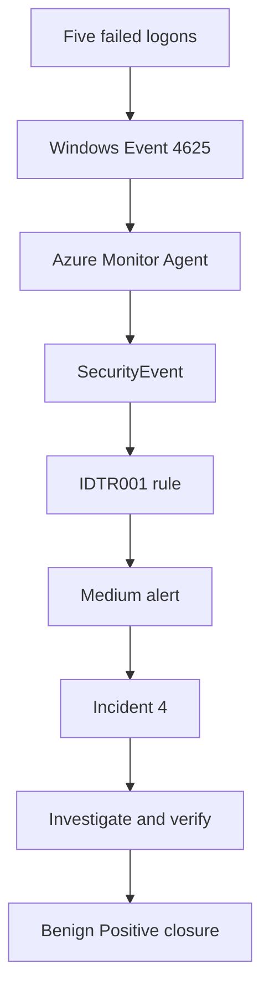
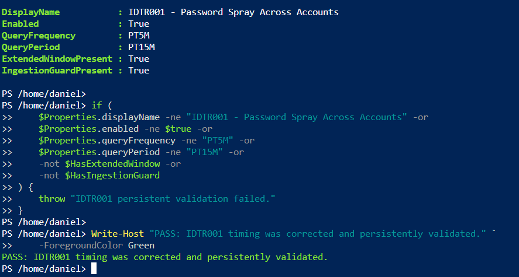
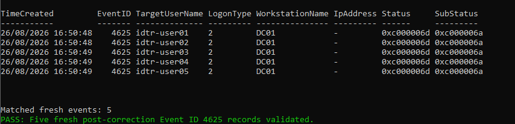
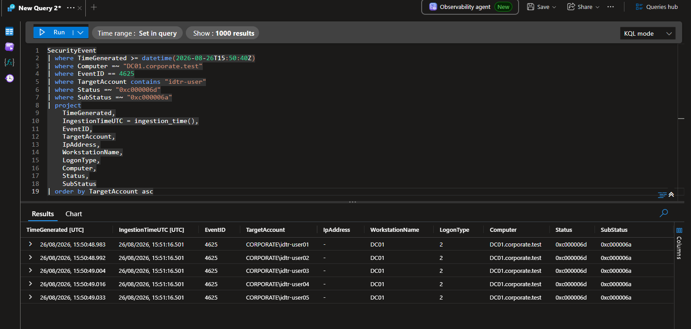
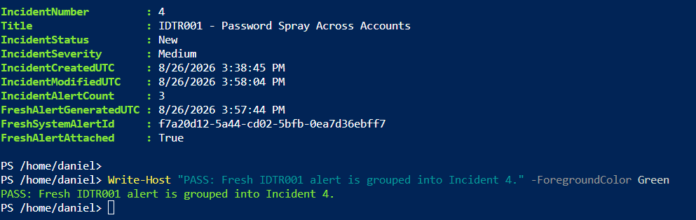
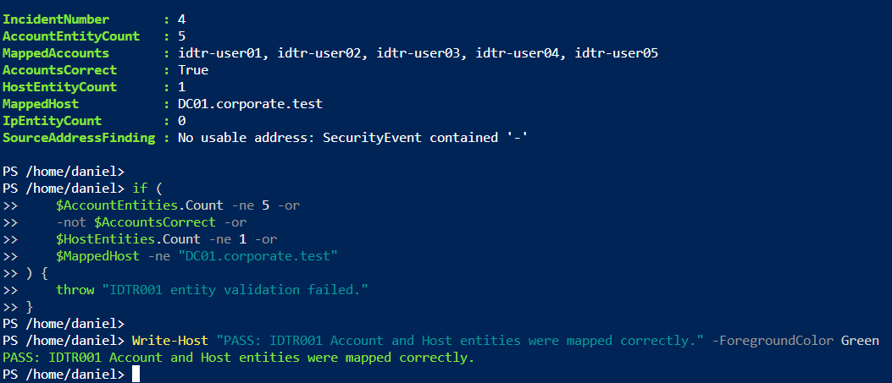
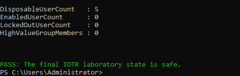
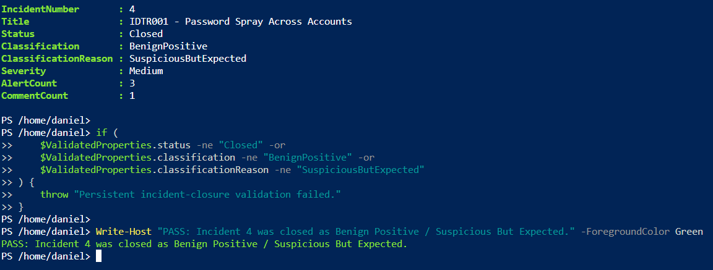

# Password-Spray Detection

## Executive summary

Milestone 3 converted the profiled Windows failed-authentication telemetry into a scheduled Microsoft Sentinel analytics rule named `IDTR001 - Password Spray Across Accounts`. The rule detects at least five invalid-password failures against five distinct controlled identities, creates mapped Account and Host entities, and groups related alerts into one incident.

The completed test produced a Medium-severity alert and grouped it into Incident `4`. The source-address field contained `-`, so no IP entity was fabricated. After investigation and independent Active Directory validation, the authorised laboratory activity was closed as **Benign Positive / Suspicious But Expected**.

## Security objective and business risk

Password spraying distributes a small number of password guesses across many
accounts. This can remain below per-account lockout or alert thresholds while
still creating a broad opportunity for credential compromise.

IDTR001 is designed to identify the horizontal pattern rather than a high
failure count against one identity. The laboratory threshold requires at least
five invalid-password failures against five distinct controlled accounts. In a
production environment, the threshold would be tuned with representative
authentication volume, identity type, source concentration and later successful
activity.

The investigation objective is not only to count failures. It is to determine:

- which identities were targeted;
- which host and source context recorded the activity;
- whether any authentication later succeeded;
- whether a high-value identity or group became involved; and
- whether current directory state proves containment before closure.

## Detection flow



## Detection design

| Setting | Validated value |
|---|---|
| Rule name | `IDTR001 - Password Spray Across Accounts` |
| Rule identifier | `7a834c24-0a7d-4248-8e27-bdfbfad028c7` |
| Data source | `SecurityEvent` |
| Windows event | Event ID `4625` — failed logon |
| Failure condition | Status `0xc000006d` and substatus `0xc000006a` |
| Threshold | At least 5 failures against 5 distinct identities |
| Query frequency | 5 minutes |
| Query period | 15 minutes |
| Ingestion guard | Event-time lookback of 15 minutes plus `ingestion_time()` limited to the latest 5 minutes |
| Severity | Medium |
| MITRE ATT&CK tactic | Credential Access |
| API technique value | `T1110` |
| Documented behaviour | `T1110.003` — Password Spraying |
| Entity mappings | Account, Host and IP; the IP entity is absent when no usable address exists |
| Alert grouping | All matching events grouped into one alert per rule run |
| Incident creation | Enabled |
| Incident grouping | Enabled; `AllEntities`; 5-hour lookback; closed incidents are not reopened |

The Microsoft Sentinel API rejected `T1110.003` because the rule data model accepted only the `T####` parent-technique format. The deployed rule therefore stores `T1110`, while this document records the more precise `T1110.003` sub-technique represented by the controlled test.

## Detection query

The reusable query is stored in [`queries/IDTR001-PasswordSpray.kql`](../queries/IDTR001-PasswordSpray.kql).

```kusto
let FailureThreshold = 5;
let IdentityThreshold = 5;
let IngestionDelay = 10m;
let RuleLookback = 5m;
SecurityEvent
| where TimeGenerated > ago(IngestionDelay + RuleLookback)
| where ingestion_time() > ago(RuleLookback)
| where Computer =~ "DC01.corporate.test"
| where EventID == 4625
| where TargetAccount contains "idtr-user"
| where Status =~ "0xc000006d"
| where SubStatus =~ "0xc000006a"
| summarize
    FirstFailureUTC = min(TimeGenerated),
    LastFailureUTC = max(TimeGenerated),
    FailedAttempts = count(),
    TargetIdentityCount = dcount(TargetAccount),
    TargetIdentities = make_set(TargetAccount, 20)
    by Computer, IpAddress, WorkstationName, LogonType
| where FailedAttempts >= FailureThreshold
    and TargetIdentityCount >= IdentityThreshold
| mv-expand TargetAccount = TargetIdentities to typeof(string)
| extend AccountParts = split(TargetAccount, "\\")
| extend
    NTDomain = tostring(AccountParts[0]),
    AccountName = tostring(AccountParts[1])
| project
    FirstFailureUTC,
    LastFailureUTC,
    FailedAttempts,
    TargetIdentityCount,
    TargetAccount,
    AccountName,
    NTDomain,
    IpAddress,
    WorkstationName,
    LogonType,
    Computer
```

The `TimeGenerated` condition recovers events that may arrive late. The `ingestion_time()` condition prevents the same event from being selected again by later overlapping rule runs.

## Controlled validation

The post-correction test began at `2026-08-26 15:50:48 UTC`. One
invalid-password attempt was generated against each of the five normally
disabled Project 2 identities. The script temporarily enabled them for the
authentication test and then restored the required disabled state.

| Validation point | Observed result |
|---|---|
| Local records | Exactly five Event ID `4625` records |
| Target identities | `idtr-user01` through `idtr-user05` |
| Local event time | `15:50:48` through `15:50:49 UTC` |
| Cloud event time | `15:50:48.983` through `15:50:49.033 UTC` |
| Cloud ingestion time | `15:51:16.501 UTC` |
| Logon type | `2` |
| Workstation | `DC01` |
| Computer | `DC01.corporate.test` |
| Source address | `-` |
| Status and substatus | `0xc000006d` / `0xc000006a` |
| Final user state | Five present, zero enabled and zero locked out |
| High-value group | Zero members |

## Ingestion-delay correction

An earlier test at `15:29:45 UTC` was ingested at approximately `15:35:38 UTC`, a delay of about five minutes and 53 seconds. The initial rule used both a 10-minute event-time query and a 10-minute query period. That configuration allowed two overlapping scheduled evaluations to select the same source activity.

The rule was corrected to:

- retain a 5-minute execution frequency;
- query 15 minutes of event time to accommodate delayed ingestion; and
- select only records ingested during the latest 5-minute rule interval.

Persistent validation confirmed `PT5M`, `PT15M`, the extended event-time window and the ingestion-time guard. The corrected test produced exactly one post-correction alert, with no duplicate occurrence in a later cycle.

## Troubleshooting and engineering lessons

The detection required three separate troubleshooting decisions:

1. A missing newly created incident did not mean that the alert was absent. The
   fresh alert had updated an existing grouped incident, so last-modified state
   and attached-alert retrieval were required.
2. The first timing design allowed delayed events to be selected by overlapping
   evaluations. Separating the event-time recovery window from the latest
   ingestion interval removed the duplicate behaviour.
3. The raw source-address value was `-`. The correct mapping decision was to
   leave the IP entity absent rather than create inaccurate evidence.

These Milestone 3 engineering decisions remain part of this detection record.
The final cross-milestone technical and repository checks are recorded in
[Repository Completion and Quality Review](Repository-Completion-and-Quality-Review.md).

## Alert and incident behaviour

The corrected activity generated the following alert:

| Field | Value |
|---|---|
| Alert name | `IDTR001 - Password Spray Across Accounts` |
| Severity | Medium |
| `SecurityAlert` time | `2026-08-26 15:57:35.267 UTC` |
| Incident-alert metadata time | `2026-08-26 15:57:44 UTC` |
| Provider | ASI Scheduled Alerts |
| Product | Azure Sentinel |
| System alert identifier | `f7a20d12-5a44-cd02-5bfb-0ea7d36ebff7` |

The alert was grouped into existing Incident `4`. The incident contained three alerts: two created by the earlier overlapping configuration and one created after the ingestion-delay correction. Validation confirmed one and only one post-correction alert.

| Incident field | Final value |
|---|---|
| Incident number | `4` |
| Resource name | `732fd57e-3005-40e5-9f64-5205d7b838ed` |
| Title | `IDTR001 - Password Spray Across Accounts` |
| Severity | Medium |
| Alert count | 3 |
| Comment count | 1 |
| Status | Closed |
| Classification | Benign Positive |
| Classification reason | Suspicious But Expected |

An initial search limited to newly created incidents returned no match because Incident `4` already existed and had been modified by the fresh alert. Retrieval by incident state and last-modified time exposed the correctly grouped result.

## Investigation findings

| Question | Finding |
|---|---|
| Which accounts were targeted? | `CORPORATE\idtr-user01` through `CORPORATE\idtr-user05` |
| Which host recorded the activity? | `DC01.corporate.test` |
| What source address was available? | None; `IpAddress` contained `-` |
| What authentication context was observed? | Interactive logon type `2` on `DC01` |
| Was the alert mapped correctly? | Yes; five Account entities and one Host entity |
| Was an IP entity mapped? | No; the source field was not usable |
| Was the activity authorised? | Yes; it was a controlled laboratory test |
| Was the final directory state safe? | Yes; all five identities were disabled, none was locked, and the high-value group was empty |

## SOC response lifecycle

1. Confirmed that the alert originated from the enabled `IDTR001` rule.
2. Correlated the alert with the five source `SecurityEvent` records.
3. Verified the mapped Account and Host entities.
4. Checked alert grouping and confirmed the fresh alert was attached to Incident `4`.
5. Verified that the corrected rule created one post-correction alert without duplication.
6. Independently validated the final Active Directory state.
7. Added an analyst comment recording the controlled-test context and validation outcome.
8. Closed Incident `4` as **Benign Positive / Suspicious But Expected**.

## Rollback and final-state validation

The password-spray simulation preserved each user's original enabled state and
restored the controlled identities after test generation. Final safety was not
inferred from the simulation output.

`scripts/Test-IDTRFinalState.ps1` independently confirmed:

```text
DisposableUserCount   : 5
EnabledUserCount      : 0
LockedOutUserCount    : 0
HighValueGroupMembers : 0
```

If any value had failed, the response order would have been:

1. Run `scripts/Restore-IDTRLabState.ps1`.
2. Re-run the independent final-state check.
3. Keep the incident open until the current state was safe.
4. Use the powered-off VMware snapshot only if targeted logical recovery could
   not restore the validated baseline.

## Evidence

The validated screenshots are displayed below. Select an image to open it at full size.

### Validated rule configuration



### Fresh local failed-authentication events



### Fresh cloud ingestion



### Generated alert


### Incident grouping



### Mapped entities



### Verified final safe state



### Closed Benign Positive incident



## Reusable artifacts

- [IDTR001 password-spray KQL](../queries/IDTR001-PasswordSpray.kql)
- [Controlled password-spray simulation](../scripts/Invoke-IDTRPasswordSpraySimulation.ps1)
- [Restore the laboratory state](../scripts/Restore-IDTRLabState.ps1)
- [Independently verify the final state](../scripts/Test-IDTRFinalState.ps1)
- [Identity incident triage and response runbook](../runbooks/01-identity-threat-detection-response-runbook.md)
- [Architecture and trust boundaries](../architecture/01-identity-threat-detection-response-architecture.md)
- [Production limitations and improvements](Production-Limitations-and-Improvements.md)

## Production considerations

- Replace the fixed laboratory thresholds with values derived from the organisation's authentication baseline.
- Scope exclusions only to documented service accounts, scanners and approved identity-testing systems.
- Add identity importance and account type so privileged and service accounts can receive stricter handling.
- Preserve the ingestion-delay guard and tune it using measured workspace latency.
- Monitor rule-run health, ingestion gaps, overlapping windows and changes in source-field population.
- Do not map placeholder or empty source addresses as IP entities.
- Review incident-grouping behaviour as identity and host volume grows.
- Use representative domain controllers and authentication paths before promoting the rule to production.

## Milestone conclusion

Milestone 3 produced a repeatable password-spray detection, validated its source events, corrected its ingestion-delay handling, proved alert and incident creation, confirmed entity mapping, documented the unavailable source address, verified the final directory state and closed the authorised test with the correct classification.

## References

- [Azure Monitor Logs reference — SecurityEvent table](https://learn.microsoft.com/en-us/azure/azure-monitor/reference/tables/securityevent)
- [Microsoft Sentinel scheduled analytics rules](https://learn.microsoft.com/en-us/azure/sentinel/scheduled-rules-overview)
- [Handle ingestion delay in scheduled analytics rules](https://learn.microsoft.com/en-us/azure/sentinel/ingestion-delay)
- [Microsoft Sentinel alert rules create or update REST API](https://learn.microsoft.com/en-us/rest/api/securityinsights/alert-rules/create-or-update?view=rest-securityinsights-2025-09-01)
- [Microsoft Sentinel incidents create or update REST API](https://learn.microsoft.com/en-us/rest/api/securityinsights/incidents/create-or-update?view=rest-securityinsights-2025-09-01)
- [Microsoft Sentinel incident comments create or update REST API](https://learn.microsoft.com/en-us/rest/api/securityinsights/incident-comments/create-or-update?view=rest-securityinsights-2025-09-01)
- [Microsoft Windows Event 4625 — An account failed to log on](https://learn.microsoft.com/en-us/previous-versions/windows/it-pro/windows-10/security/threat-protection/auditing/event-4625)
- [MITRE ATT&CK T1110.003 — Password Spraying](https://attack.mitre.org/techniques/T1110/003/)
