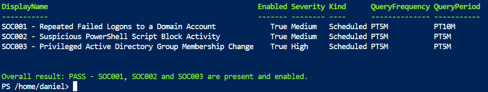
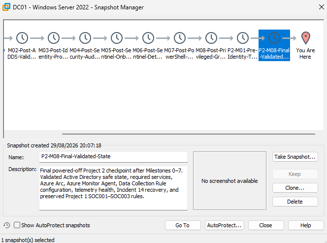

# Repository Completion and Quality Review

## Objective

Milestone 8 closes the technical Project 2 implementation with an evidence-based
review of the live laboratory, recovery boundary and published repository. The
review verifies that the final state is safe, reproducible, internally
consistent and suitable for public technical scrutiny.

## Business scenario and security risk

A detection repository can contain technically correct individual use cases and
still fail as an engineering record. Missing artifacts, broken links, stale
claims, malformed scripts, ambiguous screenshots or exposed identifiers can
undermine trust in the complete project.

This review therefore treats repository integrity as a control. It validates the
same chain expected during security operations: configured state, effective
state, stored evidence and recoverability must agree.

## Review boundary

The review covers the technical repository only:

- Architecture, implementation records and production limitations.
- Kusto Query Language validation, detection and investigation queries.
- PowerShell validation, simulation, containment and recovery scripts.
- Sanitised controlled-object data.
- Milestone 1–8 screenshots.
- Internal and external documentation references.
- Privacy and secret-exposure controls.

Non-technical preparation material remains outside the repository.

## Final live-state validation

The final checks were completed before the virtual machine was powered off:

| Area | Validated result |
|---|---|
| Domain controller | `DC01`; `corporate.test`; Active Directory domain readback passed |
| Required services | Active Directory Domain Services, Domain Name System, Active Directory Web Services, Netlogon and three Azure Arc services running with automatic startup |
| Azure Monitor Agent | `MonAgentCore.exe` running; extension files present |
| Data Collection Rule | Downloaded `mcsconfig.latest.xml` configuration present |
| Incident 14 recovery | Controlled identity state and fresh telemetry remained healthy |
| Project 1 preservation | `SOC001`, `SOC002` and `SOC003` present and enabled |

The read-only baseline produced thirteen PASS results. The preserved-rule check
returned exactly three enabled scheduled rules.



## Final recovery checkpoint

After the live-state checks passed, `DC01` was shut down cleanly and the
following VMware checkpoint was created:

```text
P2-M08-Final-Validated-State
```

The checkpoint description records the validated directory state, services,
Azure Arc components, Azure Monitor Agent, Data Collection Rule configuration,
telemetry health, Incident `14` recovery and preserved Project 1 rules.



The checkpoint is a last-resort recovery boundary. Targeted cleanup and direct
state validation remain safer than restoring an entire domain controller.

## Final repository inventory

The completed repository contains 95 approved files after publication of the
cross-milestone lessons-learned record:

| Artifact type | Count |
|---|---:|
| Markdown documentation | 13 |
| Comma-Separated Values data | 1 |
| Kusto Query Language queries | 7 |
| Portable Network Graphics evidence | 62 |
| PowerShell scripts | 12 |
| **Total** | **95** |

Screenshot numbering is complete and continuous:

| Milestone | Screenshots |
|---:|---:|
| 1 | 10 |
| 2 | 8 |
| 3 | 8 |
| 4 | 7 |
| 5 | 7 |
| 6 | 8 |
| 7 | 12 |
| 8 | 2 |

## Quality gates

The final deterministic review checks:

- Exact 95-file inventory and approved folder placement.
- Zero empty files and zero duplicate-content groups.
- Zero browser-style duplicate filename suffixes.
- PowerShell parser acceptance for every `.ps1` file.
- Valid Portable Network Graphics signatures for all 62 screenshots.
- Continuous Milestone 1–8 screenshot numbering.
- Every relative Markdown link resolves to an existing file.
- The final `README.md` status and evidence count are current.
- The two Milestone 8 images match their visually approved hashes.
- No known subscription identifier, personal cloud identity, private-key
  marker, bearer token or assigned secret appears in technical text.
- No private preparation artifact is present.

Run [`Test-Project2Repository.ps1`](../scripts/Test-Project2Repository.ps1) from
Windows PowerShell 5.1 on the physical laptop to reproduce the local checks.

## Documentation corrections completed

The final review corrected stale cross-milestone language rather than hiding it:

- `README.md` now marks Milestones 0–8 complete and reports 62 screenshots.
- The architecture now describes the completed Milestone 8 recovery boundary.
- The production-limitations conclusion now includes the validated response and
  final review.
- Deferred public-material promises were removed from earlier detection records.
- One obsolete Windows Event `4624` reference was replaced with the verified
  Microsoft Learn page already used elsewhere in the project.

## External-reference validation

Every unique Microsoft, Microsoft Learn, Azure pricing, GitHub and MITRE ATT&CK
reference was opened during the final review on 29 August 2026. Redirects to
current authoritative destinations were accepted; an obsolete Event `4624`
address that returned an error was replaced.

## Final limitations

The review proves repository integrity and the state of this controlled
laboratory. It does not convert the project into production experience or prove
enterprise scale, long-term availability, complete authentication-path
coverage, formal response authority or operational service levels.

The complete gap analysis remains in
[Production Limitations and Improvements](Production-Limitations-and-Improvements.md).

## Final conclusion

Project 2 is technically complete. The repository now presents one coherent
identity threat detection and response lifecycle: safe source activity,
hybrid collection, observed-schema detection engineering, alert and incident
validation, investigation, idempotent containment, recovery, defensible closure
and a powered-off final recovery checkpoint.

## References

- [Microsoft Sentinel scheduled analytics rules](https://learn.microsoft.com/en-us/azure/sentinel/scheduled-rules-overview)
- [Microsoft Sentinel incident investigation](https://learn.microsoft.com/en-us/azure/sentinel/investigate-incidents)
- [Azure Arc-enabled servers overview](https://learn.microsoft.com/en-us/azure/azure-arc/servers/overview)
- [Azure Monitor Agent overview](https://learn.microsoft.com/en-us/azure/azure-monitor/agents/azure-monitor-agent-overview)
- [Data Collection Rules overview](https://learn.microsoft.com/en-us/azure/azure-monitor/data-collection/data-collection-rule-overview)
- [Viewing and understanding files on GitHub](https://docs.github.com/en/repositories/working-with-files/using-files/viewing-and-understanding-files)
